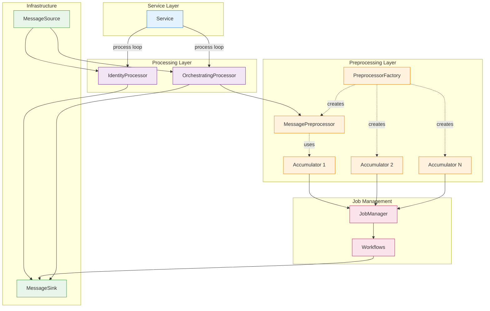
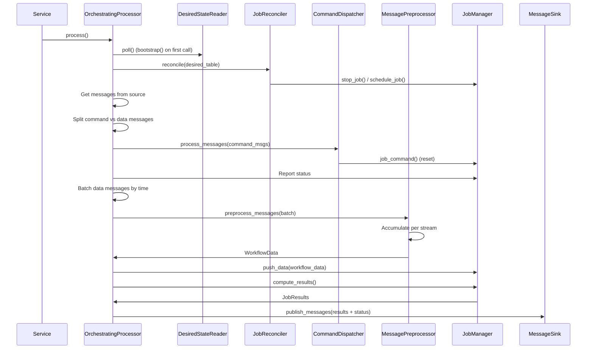
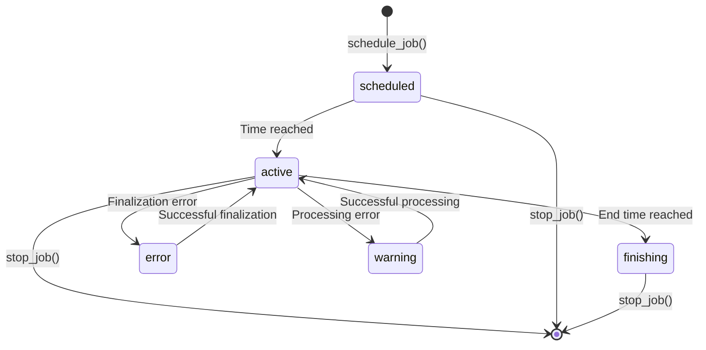

# Backend Service Architecture

## Overview

ESSlivedata backend services follow a consistent **message-driven architecture** with clear separation of concerns:

- **Service**: Manages lifecycle and processing loop
- **Processor**: Routes and batches messages (IdentityProcessor or OrchestratingProcessor)
- **Preprocessor/Accumulator**: Accumulates and transforms messages before workflow execution
- **JobManager**: Orchestrates job lifecycle and workflow execution
- **Workflow**: Implements scientific reduction logic using sciline workflows

All backend services follow this pattern, differing only in preprocessor implementations.



## Service-Processor-Workflow Pattern

This architecture provides clear separation with distinct responsibilities:

1. **Service**: Lifecycle management and processing loop
2. **Processor**: Message batching and pipeline coordination
3. **MessagePreprocessor**: Routes messages to appropriate accumulators
4. **Accumulator**: Accumulates and transforms messages per stream
5. **JobManager**: Job lifecycle and workflow execution coordination
6. **Workflow**: Scientific reduction logic on accumulated data

### Two Processor Types

**IdentityProcessor**: Simple pass-through for fake data producers (no preprocessing or job management).

**OrchestratingProcessor**: Full job-based processing for all backend services:

- Job reconciliation against the desired state
- Command handling (reset)
- Time-based message batching
- Preprocessing via accumulators
- Job lifecycle management
- Workflow execution
- Periodic status reporting (every 2 seconds)

**Processing Flow**: Reconcile jobs against the desired state → Source → Split commands/data → Apply commands to jobs → Batch data by time → Preprocess/accumulate → Push to JobManager → Compute workflows → Publish results

### Service Layer

Manages lifecycle, signal handling (SIGTERM/SIGINT), background threading, and resource cleanup via `ExitStack`. Supports step-by-step execution for testing.

### Preprocessor Layer

**PreprocessorFactory** creates stream-specific accumulators on-demand. Common preprocessors in `preprocessors/`: `GroupByPixel`, `ToNXevent_data`, `ToNXlog`, `Cumulative`, `LatestValueAccumulator`. Implement `Accumulator` protocol with `add()`, `get()`, `clear()`.

## Job-Based Processing Architecture

All backend services (monitor_data, detector_data, data_reduction, timeseries) use the same job-based architecture:



**JobReconciler** (see `core/job_reconciler.py`) starts and stops jobs so that they match the desired table, read from the desired-state topic (see [ADR 0012](../adr/0012-desired-state-topic-for-job-control.md)). It builds at most one job per cycle. A job that fails to build is reported in the heartbeat with state `error`. **CommandDispatcher** (see `core/command_dispatcher.py`) handles `job_command` messages (reset only), delegating to **JobManagerAdapter** (see `core/job_manager_adapter.py`), which bridges CommandDispatcher and JobManager. Other key features: time-based batching, preprocessing accumulation, job lifecycle management, periodic status reporting.

## Message Flow in Backend Services

For a detailed view of the message source chain, adapter composition, and message transformations, see [](message-flow-and-transformation.md).

## Job-Based Processing System

`OrchestratingProcessor` uses job management for multiple concurrent data reduction workflows.

### Job Lifecycle

```{note}
The error/warning states are not fully exclusive in the current implementation — a job can transition between them. This state machine is a simplification.
```



**Job States**: `scheduled` (waiting for start time) → `active` (processing) → `finishing` (end time reached). `stop_job()` removes the job from the system. Error states: `error` (finalization failure), `warning` (processing error).

### JobManager

Orchestrates job operations: `schedule_job()`, `push_data()` (activates/processes jobs), `compute_results()` (only for jobs with primary data), `stop_job()`, `reset_job()`, `get_job_status()`.

**Key Features**: Time-based activation, primary data triggering, auxiliary data handling, error isolation, status tracking.

### Primary vs Auxiliary Data

**Primary Data** (triggers job activation and computation): Detector/monitor events specified in `WorkflowSpec.source_names`.

**Auxiliary Data** (non-triggering metadata): Sample environment, geometry, etc. Available auxiliary sources are defined in `WorkflowSpec.aux_sources` (a Pydantic model); selected stream names are provided per-job in `WorkflowConfig.aux_source_names`.

Prevents unnecessary computations when only metadata updates; enables efficient slow/fast-changing data handling.

### Job Scheduling

Jobs process specific time ranges via `JobSchedule(start_time, end_time)`. All times in nanoseconds since Unix epoch (UTC), based on data timestamps not wall-clock time.

## Service Lifecycle Management

### Graceful Shutdown

Services handle SIGTERM/SIGINT gracefully: Signal received → Set `_running = False` → Exit processing loop → Join background threads → Cleanup resources (consumers, producers) → Exit.

### Resource Management

Services use `ExitStack` for automatic resource cleanup on service exit or errors.

### Error Handling

**Service Loop**: Processor exceptions logged, service stops and signals main thread (prevents running with broken processor).

**Preprocessor Errors**: Per-stream exceptions caught, logged, other streams continue. PreprocessorFactory may return None for unknown streams (skipped silently).

**Job Errors**: Processing errors → `warning` state; Finalization errors → `error` state. Job continues, errors in status messages, other jobs unaffected.

## Building Services with DataServiceBuilder

`DataServiceBuilder` constructs services consistently with `OrchestratingProcessor` by default. For command-line services, `DataServiceRunner` (see `service_factory.py`) wraps a builder and adds standard CLI arguments (`--instrument`, `--dev`, `--log-level`, `--scheduler`, `--job-threads`). The `--scheduler` option selects the scheduler sciline uses for workflow execution (default `naive`, which avoids per-cycle dask overhead; see `ess.livedata.core.sciline_scheduler`). Services can publish initialization messages on startup for workflow specifications or configuration values.

